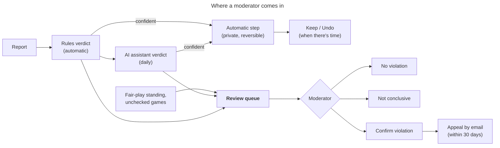

# Moderator runbook

> This file is the master copy of the moderators' operation manual. Update it here, in the same commit as any change to the tools it describes. The reasoning behind the rules is in [v0.3-online-design.md](v0.3-online-design.md) ("Fair play", "Reports", "Sanctions and appeals", "Moderation", "Report triage").

Oct 18, 2026 · for the moderators of Xiangqi School

## The job in one paragraph

Players report opponents; the site gathers evidence on its own (fair-play statistics from both players' browsers, sportsmanship marks from the server's clock, both browsers' chat records), and rules and an AI assistant give each report a first verdict. Confident verdicts take private, reversible steps on their own, which a moderator keeps or undoes later ([Automatic steps](#automatic-steps-triage-phase-2)). A moderator decides only what needs a person: anything public (a violation mark, a suspension, rating refunds), second offences, appeals, and the cases the rules and the adviser can't settle. Two principles never bend: **one game proves nothing**, and **a person confirms before anything public happens**.



## Access

- The review page: **https://jetzhu.github.io/xiangqi/en/moderate/** (or `/zh/moderate/`). It isn't in the menu; bookmark it. Signed in as a moderator you see the queue; anyone else sees "This page is for moderators."
- Moderators are listed in the database table `moderators`, never in the repository. Current: **jetzhu** and **JianJetZhu**.
- Appeals arrive by email at the contact address on the fair-play and privacy pages: **jianjetzhu@gmail.com**.

Adding or removing a moderator (see [Database commands](#database-commands)):

```
node packages/db/scripts/sql.mjs --write "insert into public.moderators (user_id) select user_id from public.profiles where lower(username) = 'newmod'"
node packages/db/scripts/sql.mjs --write "delete from public.moderators where user_id = (select user_id from public.profiles where lower(username) = 'oldmod')"
```

## A daily round (about 5 minutes when quiet)

1. Open the review page and read the **daily summary** at the top ([The daily summary](#the-daily-summary-and-the-ai-assistant)).
2. Keep or undo the **automatic steps** waiting for a look ([Automatic steps](#automatic-steps-triage-phase-2)). They're already in force, so this can wait for a day when you have time.
3. Work the cases from the top: they're ordered by strength of evidence, then rating. For each, read it ([Reading a case](#reading-a-case)), write a reason, decide ([Decisions](#decisions)).
4. File new items on the **Feedback** tab ([Feedback](#feedback)).
5. Check your email for appeals, and record each one ([Appeals](#appeals)).

An empty queue says "Nothing to review." That's the normal state.

## The queue

A player is in the queue when they have at least one of: an open report, a fair-play standing of "watch" or "likely", or games whose fair-play check is missing or disputed. Once you decide a case it leaves the queue, and comes back only with **new evidence**: a new report, a newly checked or unsettled game, or a worse standing.

| Column | Meaning |
| --- | --- |
| Player | Opens the case. |
| Rating | Their highest online rating. |
| Standing | Their strongest fair-play verdict (normal, watch, likely) and combined score. |
| Reports (weight) | Distinct reporters with open reports, and the sum of those reporters' weights (see [Reporters](#reporters)). One person reporting five times counts once. |
| Unchecked games | Games whose two analyses disagreed, or a strong player's game nobody checked. |
| Triage (rules) | How the rules judged the open reports: likely valid, likely invalid, inconclusive. |
| Last decision | For a returning case: what was decided before, when, and your note. |

## Reading a case

The case page, top to bottom:

- **Header:** account age, completion rate (棋品), checked-game count, their own record as a reporter, whether they're barred from reporting.
- **Last decision**, if any, with its note.
- **Standing** per speed: rating (± uncertainty, games), scored games, combined score, games far out of line, verdict. The combined score is in standard deviations above honest players of the same rating, over their last 20 checked games; "likely" needs at least 10 games (15 in Lightning), a combined score of 5 or more and 3 games far out of line. Statistics alone at that level are strong evidence; anything lower only adds weight to other evidence.
- **Reports:** date, reason, reporter (with their record and weight), status, note, and under each one the verdicts: **Rules** and, once run, **AI: claude-code**, each with a confidence and a reason in a line.
- **Rated games** (last 30): opponent, result, sportsmanship marks (stalled, abandoned, aborted, slow-start), and the fair-play check of this player's side:
  - **Accuracy** and **Engine match**: middle-game moves (plies 16–120, forced moves skipped).
  - **z**: how far above honest players of the same rating, in standard deviations, for this one game.
  - **Flags and timing**: `even-times` (move times unusually even), `few-fast` (almost no quick moves, Lightning and Blitz only), `focus` (the page lost focus on most moves), `flat-difficulty` (no extra time on hard positions), with the figures behind them.
  - **Chat**: open it to see the phrases both browsers recorded. "The two records differ" means one browser left something out or added it; that's evidence about that browser.
  - **Check status**: `checked`, `one` (only one browser's analysis), `disagree`, `missing`. For anything but `checked`, **Analyse in my browser** runs the engine on your machine and settles the check with your analysis (keep the tab open until it says "Game checked").
- **Sanctions** with their appeal state and buttons.
- **Log**: every action on this player, with the moderator and note.

What to look for, by report reason:

| Reason | Strong evidence | Weak or no evidence |
| --- | --- | --- |
| Engine help | "likely" standing; several games with z of 3 or more and flags; reports from several reporters with good records | One strong game; a "normal" standing over 10+ games; a single report after a loss |
| Stalling | A "stalled" or "abandoned" mark on that game (the server's clock decided it) | No mark: the player was within their time |
| Abusive chat | Many phrases, or the same one repeated, in both browsers' records | One or two phrases ("gg", "oops") |
| Username | Offensive by any reasonable reading | Odd, or a word in another language you don't know: check before acting |
| Other | Read the note; usually needs the evidence above | |

## Decisions

Every decision needs a **reason and evidence** in the note box; it goes into the log forever.

| | No violation | Not conclusive | Confirm violation |
| --- | --- | --- | --- |
| When | The evidence shows the player played fair | Not enough evidence either way | The evidence shows a violation |
| Open reports | Dismissed | Stay open | Upheld |
| Reporters' records | Count as not upheld | Unchanged | Count as upheld |
| Reporters told | No | No | Yes: "action was taken" (no details) |
| Player's standing | Starts fresh from today | Keeps counting every game | — |
| Quiet matching (a "likely" player plays only others like them) | Ends | Continues (private) | — |
| Case in the queue | Leaves | Leaves; returns with new evidence | Leaves |

**Confirm violation** takes two clicks and applies the sanction automatically:

| | First confirmed violation | Second |
| --- | --- | --- |
| Online play | Rated play suspended for 30 days; casual games with friends still allowed | All online play suspended at once |
| Ratings | Reset to a new player's (bot rating or 800, high uncertainty) | — |
| Refunds | Every opponent gets back the rating they lost to the player in the last 3 months (up to 100 games), and a notice | Same |
| Public | "Fair-play violation confirmed on <date>" on the profile for a year | Same |
| Closure | — | Online play closes if no appeal is received within 30 days, or the appeal is rejected |

The player sees their sanction, its end date and how to appeal on the Play online page.

**When in doubt, choose Not conclusive.** It costs nothing: the evidence keeps building and the case comes back.

A mistaken confirmation is undone through the appeal buttons: record **Appeal received**, then **Overturn**. That lifts the suspension and the public mark. Refunds already paid stay paid, and the player's reset ratings are not restored automatically; note it in the log and fix ratings by hand if needed.

## Appeals

Appeals come by email within 30 days of a confirmed violation.

1. Open the player's case, find the sanction, and click **Appeal received** (note: date and summary of the email). At the second level this holds the closure until you decide.
2. Review the case again with fresh eyes, ideally by the other moderator. For a genuinely disputed case, an option is a watched game against a trusted player at their level, arranged by email.
3. Click **Reject appeal** (the sanction stands, and closes at the second level) or **Overturn** (lifted). The player gets a notice either way.
4. Reply to the email.

## Reporters

Each reporter has a record: reports decided and upheld. Their reports weigh (upheld + 1) ÷ (decided + 2): a new reporter starts at 0.5, an accurate one approaches 1, and one who reports every loss approaches 0. Reporters with a confirmed violation of their own count for nothing.

For persistent false reporting, open the reporter's own case (`/en/moderate/?u=<username>`), write the reason, and click **Bar from reporting**. Their reports then carry no weight and they can't make new ones. **Allow reporting again** reverses it.

Limits players can't exceed: a report only by a player of that game, within 7 days, once per game, 5 a day.

## Sportsmanship corrections

Sportsmanship (棋品) is automatic: each game's marks (left, stalled, aborted, slow start) come from the server's clock, and the completion rate, warnings and pairing waits follow. The completion rate counts from a player's first game, from a clean record worth 5 finished games: (finished + 5) ÷ (games + 5) over the last 90 days. Two corrections, both on the case page and both logged with your note:

- **Excuse** next to a mark on one of the player's games removes that mark (a fault on our side, a test game). The rate and any penalty follow at once.
- **Reset sportsmanship record** makes only games from now count, and clears any pending warning (test accounts, or after a run of site problems).

Open any player's case with **Open a player's case** on the queue page. For developers, the same functions from the command line, acting as a moderator account so the action is logged under that moderator:

```
node packages/db/scripts/sql.mjs --write "begin; select set_config('request.jwt.claim.sub', (select user_id::text from public.profiles where username = 'jetzhu'), true); select public.mod_reset_sportsmanship('name', 'why'); commit;"
node packages/db/scripts/sql.mjs --write "begin; select set_config('request.jwt.claim.sub', (select user_id::text from public.profiles where username = 'jetzhu'), true); select public.mod_excuse_label('<game id>', 'name', 'aborted', 'why'); commit;"
```

## Automatic steps (triage phase 2)

Since 2026-10-21 triage acts on its own, with private, reversible steps only. The **Queue** tab shows them first, under **Automatic steps**:

| Step | When | Undo gives back |
| --- | --- | --- |
| Close the report | A confident "likely invalid" verdict (any reason); or a confident "likely valid" stalling report, since the game's marks already count | The report, open again |
| Pause chat for 7 days | Confident "likely valid" abusive chat, first time | Chat at once |
| Hide the username | Confident "likely valid" offensive username, first time | The old name, unless the player has already chosen a new one (the old name stays reserved until then) |

- **Who acts:** the rules, at once and hourly; the AI assistant, once a day, only when it is confident (0.8+) and the rules don't say the opposite.
- **Never automatic:** engine findings (quiet matching already applies), "other" reports found valid, second offences (an earlier step of the same kind that was kept, or a sanction in the last 180 days), anything public, appeals.
- **Your part:** on your daily round, look at each step waiting. **Keep** decides its report (upheld for "likely valid", which tells the reporter action was taken; dismissed for "likely invalid"). **Undo** reverses it and reopens the report for a normal decision. Both count in the agreement table.
- **Self switch-off:** when more than 1 in 10 of a category's last 20 reviewed steps were undone (and at least 2), that category stops acting and the log shows `auto-off`. Fix the cause (the rule's numbers, the word list), then turn it back on in **Automatic steps by category**, with a reason.
- Reports closed automatically don't count for or against the reporter until you keep the step.

## The daily summary and the AI assistant

Once a day the AI assistant, which runs on the owner's PC, gives open reports its verdict, which may take a step as above. It then writes the **daily summary** shown at the top of the Queue tab:
- the day's figures (steps taken, steps waiting, open reports, categories switched off, new feedback)
- the feedback grouped into themes
- anything unusual

If the summary is more than two days old, the page says so: check the timer on the PC.

```
packages/triage/scripts/install-timer.sh               # install the daily timer (07:30, and at log-in if missed)
systemctl --user start xiangqi-triage                  # run once now
journalctl --user -u xiangqi-triage                    # what it did
packages/triage/scripts/install-timer.sh --uninstall   # remove it
```

To run it by hand, without saving anything first:

```
cd ~/Projects/OOPolaris/ChessWebsite
SUPABASE_ACCESS_TOKEN=$(tr -d '\n' < ~/.config/xiangqi-supabase-token) ~/.local/node/bin/node packages/triage/scripts/triage.mjs --dry-run   # prints verdicts and the summary, saves nothing
packages/triage/scripts/run-daily.sh                                                                                                    # the real run, as the timer does it
```

- Each run takes up to 20 reports (`--limit N`), only those it hasn't seen since they last changed, and skips any answer it can't read.
- To use another AI, copy the example config to `~/.config/xiangqi-triage.json` and set `"adviser"` ([triage.config.example.json](../packages/triage/triage.config.example.json)). API keys go in environment variables named by `apiKeyEnv`, never in the file.
- What it's sent: usernames, the report's reason and note, the game's result, chat and fair-play figures, the rules' verdict, and for the summary the day's figures and feedback text. Never email addresses. The privacy policy says so.
- When the Supabase access token expires, the run fails (see the journal): save a new token as below.

## Feedback

The **Feedback** tab on the review page lists what people sent from the Feedback page (`/feedback`): open items (new, noted, planned) first, or one status at a time.

- Read the new ones on your daily round. Give each a status (noted, planned, done, won't do) and, if useful, a private note.
- Reply by email **only** where an address is shown: the sender ticked "you may reply to my account email". Guests can't be replied to, by design (no child's email is ever collected).
- Never quote feedback publicly with a username. A bug worth tracking publicly goes to GitHub in your own words.
- Done and declined items are deleted after 12 months, the rest after 24 (daily job `purge-old-feedback`).

## Site settings

The **Site settings** tab keeps things the site shows that change without a release, each change logged with its reason:

- **Donation links** for the Support page: a Stripe Payment Link (`https://buy.stripe.com/…`) and a GitHub Sponsors page (`https://github.com/sponsors/…`). Any other address is refused. Leave one empty to hide its button.
- **Operator contact** shown in the privacy policy.

## Private settings

These live in the database, not the repository (the repository is public, so the starting values in the migrations are public; changes made with these commands are not).

| Table | What | Example |
| --- | --- | --- |
| `username_blocklist` | Words that make a username offensive (3+ letters, lower case, matched inside names). Empty at first. | `insert into public.username_blocklist (word) values ('…')` |
| `fairplay_config` | Fair-play thresholds: `likely_z` (5), `watch_z` (3), `far_z` (2.5), `far_games` (3), `min_games` (10), `min_games_lightning` (15), `always_check_rating` (1800), baselines and flags | `update public.fairplay_config set value = 5.5 where key = 'likely_z'` |
| `triage_config` | The rules' numbers (`chat_spam_count` 5, `chat_repeat` 3, `engine_min_checked` 10), the steps' numbers (`auto_min_confidence` 0.8, `mute_days` 7) and the switches (`auto_chat`, `auto_engine`, `auto_other`, `auto_stalling`, `auto_username`; use the review page for these) | `update public.triage_config set value = 4 where key = 'chat_spam_count'` |

Change fair-play thresholds rarely and note why in a log-like place (an email to yourself is fine): they decide who is matched with whom.

## Database commands

`packages/db/scripts/sql.mjs` runs one SQL statement. It's **read-only unless you add `--write`**, so looking can never change anything.

```
cd ~/Projects/OOPolaris/ChessWebsite
export SUPABASE_ACCESS_TOKEN=$(tr -d '\n' < ~/.config/xiangqi-supabase-token)
~/.local/node/bin/node packages/db/scripts/sql.mjs "select * from public.triage_config order by key"
~/.local/node/bin/node packages/db/scripts/sql.mjs --write "insert into public.username_blocklist (word) values ('…')"
```

Useful read-only queries:

| Question | Query |
| --- | --- |
| Who are the moderators? | `select p.username, m.added_at from public.moderators m join public.profiles p using (user_id)` |
| Open reports by reason | `select reason, count(*) from public.reports where status = 'open' group by 1` |
| Players under quiet matching | `select p.username, f.speed, f.score from public.fairplay f join public.profiles p using (user_id) where f.verdict = 'likely'` |
| The last 20 moderator actions | `select at, action, details->>'note' from public.mod_log order by at desc limit 20` |
| Sanctions in force | `select p.username, s.level, s.suspended_until, s.appeal from public.sanctions s join public.profiles p using (user_id) where s.overturned_at is null` |

The Supabase access token expires; when a command says "Invalid access token", create a new one at supabase.com/dashboard/account/tokens and save it to `~/.config/xiangqi-supabase-token` (mode 600).

## What runs on its own

| Job | When | What |
| --- | --- | --- |
| `process-game-reports` | every 5 s | Moves browsers' reports into the game log; ends games nobody reports on for 10 minutes |
| `clear-seeks` | every minute | Clears abandoned quick-pairing searches |
| `mark-unchecked-games` | hourly (:17) | Strong players' and leaderboard players' rated games that nobody checked within a day join the queue |
| `retriage-open-reports` | hourly (:41) | The rules look at open reports again as evidence arrives, and act when confident |
| Daily triage (owner's PC) | 07:30, or at log-in if missed | The AI assistant's verdicts and steps, then the daily summary |
| `purge-old-digests` | daily (03:39 UTC) | Deletes summaries older than 12 months |
| `purge-old-game-records` | daily (03:23 UTC) | Deletes detailed game records older than 12 months, except where a report, an undecided case or an appeal involves a player |
| `purge-old-feedback` | daily (03:35 UTC) | Deletes feedback 12 months after it was done or declined, 24 months after it was sent |
| `purge-deleted-accounts` | daily (03:17 UTC) | Finishes account deletions after their 10-day wait |
| `pack-game-logs` | daily (03:29 UTC) | Packs the per-move log of games over for more than 8 days into one value per game (a sixth of the size) |
| Sportsmanship | at the end of each game | Marks, completion rate, warnings and pairing waits: no moderator involved |
| Keep-alive, weekly backup | GitHub Actions | Keeps the free project awake; encrypted backup |

## Conduct

- Never discuss a case, a report or a reporter with anyone but the other moderator. Reporters are told only that action was taken; reported players are never told who reported them.
- Decide on evidence, not on reputation, rating or how often someone was reported.
- If you know a player personally, or played the game in question, leave the case to the other moderator.
- Every action is logged permanently; write notes you'd be comfortable having read back in an appeal.
