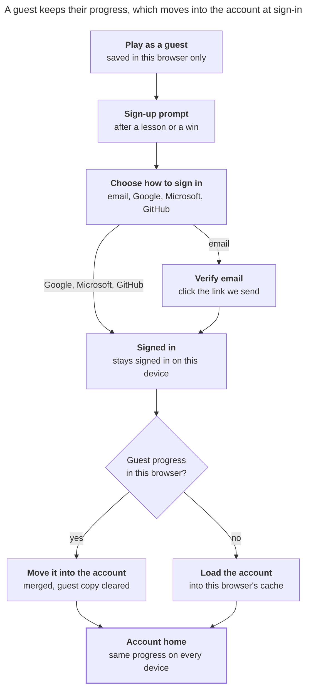
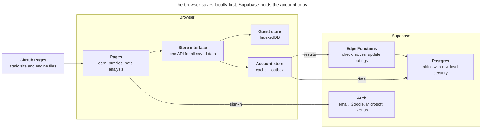

# Xiangqi School v0.2 — Accounts design

> This file is the master copy of this design document. It was first drafted in Claude Docs and moved here on 2026-10-10; update it here, in the same commit as the change it describes.

Oct 6, 2026 · Jet Zhu

v0.2 adds optional accounts: everything stays free to try as a guest, and signing in keeps progress, ratings and game history on any device. Accounts run on Supabase while the site stays a static site on GitHub Pages.

## Decisions

All four were chosen on 2026-10-06; the rest of this doc builds on them.

| Decision | Choice | Why |
| --- | --- | --- |
| Backend | Supabase (hosted auth + Postgres) | Email and social sign-in built in; row-level security lets the browser talk to the database directly, so the site stays static on GitHub Pages. Open source, so it can be self-hosted later (e.g. in China). |
| Sign-in methods | Email + password, Google, Microsoft, GitHub (Apple dropped on 2026-10-08) | Email for everyone, Google as the common one-click option, Microsoft for Outlook/Hotmail and school or work accounts, GitHub for testers. Apple needs a paid developer account and is left out. |
| Guest progress at sign-up | Moved into the new account | People who just finished three lessons should not lose them by signing up. |
| Scores | Separate ratings: bot rating, puzzle rating, later an online rating; plus win/loss/draw totals | One number mixing bots, puzzles and people would mean nothing. Chess.com leaves bot games unrated; we rate them, because each bot has a fixed strength. |

One rule from the brief stays as it is: without an account nothing follows the player to another browser or device.

## Guest vs signed in

Nothing is locked behind sign-up: a guest can use every feature, and the difference is only what is kept and where. This is looser than chess.com, which locks online play, game analysis and saved analysis for guests.

| Feature | Guest | Signed in |
| --- | --- | --- |
| Lessons | All lessons; progress kept in this browser only | Progress saved to the account, on every device |
| Puzzles | All puzzles; rating kept in this browser only | Puzzle rating and history in the account |
| Bot games | All bots, hints, takebacks, move feedback; crowns kept in this browser | Every game saved to history; bot rating; crowns in the account |
| Analysis board | Full engine; share links | Plus saved analyses and studies |
| Settings | Kept in this browser | Follow the account to every device |
| Learning rank, streak | Shown, this browser only | Kept across devices; streak counts any device |
| Profile, stats page | — | Username, avatar, ratings, win/loss/draw |
| Online play (later) | Not planned for guests | Rated games against people |

What "this browser only" means for a guest:

- Progress survives closing the tab and coming back in the same browser.
- Another browser or device starts from zero.
- Clearing site data, or a private window, starts from zero.
- Signing up moves it into the account (see the next section).

## Sign-up, sign-in and merge

Whenever a browser with guest progress signs in, to a new or an existing account, that progress moves into the account; a browser without guest progress just loads the account.

Sign-up asks for as little as possible. Chess.com asks for skill level, email and password, username and board theme; we ask for the sign-in method, a username and a skill level, and nothing else up front.

1. **Prompt.** A banner, "Create an account to keep your progress", shows after finishing a lesson, beating a bot or solving 5 puzzles, and stays in the header as Sign up / Log in. It never blocks a feature, and "Not now" hides it for 7 days.
2. **Method.** Email and password, or one click with Google, Microsoft or GitHub, which return to the site through `/auth/callback/`.
3. **Email check.** An email sign-up stays a guest until the verification link is clicked.
4. **Username.** chess.com's rules: 3–20 letters, digits, \_ or -, starting and ending with a letter or digit, not all digits, unique ignoring case, checked against a Chinese and English blocklist (profanity, politics, impersonating staff or bots). Suggested from the email or provider name; children are told not to use their real name. One change every 90 days.
5. **Import.** If the browser has guest progress, it moves in, and the welcome message says what was kept. Then one question, "How well do you know Xiangqi?": new (400), know the rules (800), club player (1200), strong (1600), which sets the starting bot and puzzle ratings. A guest who already has a puzzle rating skips it.

**Merge rules for guest progress**

| Data | Rule |
| --- | --- |
| Lesson progress | Keep the better status for each lesson (mastered > started > new). |
| Bot games and crowns | Guest games are added to history as casual games, so they don't change the bot rating; crowns follow the wins. |
| Puzzle attempts | Guest attempts are added to history; if the account has no puzzle rating yet, the guest rating becomes its starting rating, otherwise the account rating stays. |
| Settings | The account's settings win; a new account takes the guest's. |
| Saved analyses | All copied in. |

The import runs once per browser and can't run twice: afterwards the guest copy is cleared, and this browser holds only the account cache.

**Signing out** clears the cache and returns the browser to an empty guest state.

## Ratings and records

Each account has one rating per kind of play, all on the same Glicko scale the puzzles already use (starting at the skill level chosen at sign-up, 800 if skipped; uncertainty 200), plus plain win/loss/draw totals.

| Rating | Moves on | How it works |
| --- | --- | --- |
| Bot rating | Rated games against bots | Win, loss or draw against the bot's fixed rating. A bot is a fixed-strength opponent, so its rating counts as certain. |
| Puzzle rating | Rated puzzles | As today: warm-ups and hinted solves don't count; a change is capped at ±80 per puzzle. |
| Online rating (later) | Rated games against people | Both players' ratings move. Kept separate, because results against people and against bots differ. |

**Which bot games are rated.** The player chooses Rated or Casual before the game; Rated is the default once signed in.

- A rated game turns off hints and takebacks; move feedback appears only after the game.
- Casual games keep every learning aid and leave the rating alone.
- Guests can play rated games too, against a rating kept only in their browser (built in M8). At sign-up their games move into the account as casual, so the account's rating starts from the skill question.
- Leaving a rated game after both sides have moved counts as a loss, so the rating can't be protected by closing the tab. Before both sides have moved there is an Abort button instead, and an aborted game is not counted.

**Rating rules from chess.com** ([ratings](https://support.chess.com/en/articles/8566476-how-do-ratings-work-on-chess-com), [rating didn't change](https://support.chess.com/en/articles/8614310-the-game-ended-and-my-rating-didn-t-change-at-all-why), [saving bot games](https://support.chess.com/en/articles/8609271-can-i-save-my-games-against-the-bots)):

- A game is saved to history automatically once it reaches 4 plies, and counts for rating and stats only if it is rated and that long.
- Uncertainty grows with time away, so a returning player's rating moves faster at first. A "?" marks a rating while its uncertainty is high.
- The result screen always says why the rating changed or didn't: casual game, aborted, too short.
- A hint in a rated puzzle counts as a fail, and there are no participation points: chess.com had to re-rate every puzzle player in 2025 to undo that inflation.
- Bot rating is practice, not competition: anyone can run an engine beside a bot game. It is labelled "vs bots", never ranked, and a win against a bot rated 400 or more below the player gains almost nothing, which stops farming weak bots.

**Records kept per game:** the opponent, colour, result and how it ended, the full move list, start time and length, rated or casual, the rating before and after, and the move-quality counts from the review. A finished game opens in the analysis board, and its review is computed once and saved.

**Totals shown:** wins, losses and draws overall, per bot and per colour, and the best win (the highest-rated bot beaten).

The bot ratings in `bots.json` are labels picked by hand. They need checking against real results before the bot rating can be trusted (see Open questions).

## The signed-in experience

Signing in should feel like the site now remembers you: the home page becomes a dashboard, and every page picks up where you left off on any device. Chess.com's logged-in home is the model (play options, next lesson, puzzles, game history, daily puzzle, streak, stats).

| Page | What changes when signed in |
| --- | --- |
| Header | Avatar and username with a menu: Profile, Game history, Stats, Settings, Sign out. Guests see Sign up and Log in instead. |
| Home | Dashboard: Continue (next lesson or last unfinished game), today's puzzle, streak, the three ratings, the last 5 games with Review links, and the next bot to beat. |
| Game history (new) | Every game, newest first: opponent, result, rated or casual, rating change, moves, date. Filter by bot, result and colour; each row opens the review in the analysis board. |
| Stats (new) | A rating chart for each rating (last 90 days by default) with the peak and its date; best win; longest win streak; wins, losses and draws by bot and by colour; puzzle accuracy by theme; lessons mastered. |
| Profile (new) | Username, avatar, country flag (optional), learning rank, bot crowns, member since, the three ratings. Private by default; public profiles come with online play. |
| Analysis | Save a position or game to My analyses, with its tree and comments. |
| Settings | Saved to the account, so board, pieces, notation and language follow the player. A new Account tab holds the sign-in options (see Account management). |

**Small touches that make an account feel worth having**

- After sign-up, a short welcome: "Your 3 lessons and 12 puzzles are saved."
- Streak, as chess.com counts it: a game, a puzzle, a finished lesson or a game review keeps the day; 2 missed days are forgiven and the third resets it; a lost streak can't be restored ([streaks](https://support.chess.com/en/articles/9714718-what-are-streaks)). A reminder email only if the player opts in.
- Milestones: first lesson mastered, first bot beaten, puzzle rating +100, shown once on the dashboard. Milestones not yet earned show grey with what it takes, as chess.com's achievements do.
- Every finished game ends with "Review this game", and reviewed games keep their result for later.
- Sign-in lasts until the player signs out (refreshed in the background), so returning players are never asked to log in again on the same device.

## Architecture and data

The browser keeps working from local storage as it does today, and a signed-in browser also syncs that data with Supabase. Pages never talk to storage directly: they use one store interface with a guest version (IndexedDB, as now) and an account version (IndexedDB cache plus Supabase).

Game results and puzzle attempts go through server functions; progress, settings and analyses are written straight to Postgres under row-level security.

**Today, per browser:** lesson progress, bot crowns, puzzle rating and history, and saved analyses sit in IndexedDB (`learn/progress.ts`, `bots/crowns.ts`, `puzzles/store.ts`, `analysis/storage.ts`); settings sit in localStorage. Bot games are not recorded at all yet.

**Tables (Postgres, one row owner per row):**

| Table | Holds | Who writes |
| --- | --- | --- |
| `profiles` | username (unique), avatar, country, created | The user, through the API |
| `settings` | the settings object | The user |
| `lesson_progress` | lesson id, status, updated | The user; status never goes down |
| `bot_games` | bot, colour, moves, result, ending, rated, ratings before/after, review, times | Server function only |
| `puzzle_attempts` | puzzle id, score, rating after, time | Server function only |
| `ratings` | kind (bot, puzzle, online), rating, uncertainty, games | Server function only |
| `analyses` | title, game record with tree and comments, updated | The user |

Crowns are not stored: they are the bots with a won game in `bot_games`.

**Access rules.** Row-level security on every table: a user reads and writes only rows where `user_id = auth.uid()`. The public key built into the site can do nothing else. Ratings and game results are written only by server functions, so a player can't edit their own rating from the browser console.

**Server functions** (Supabase Edge Functions, TypeScript) reuse `xiangqi-core` and `@xq/puzzles`:

- `record-bot-game` (built as part of one function, record): replays the moves, checks they are legal and that the result matches the final position, then updates the bot rating.
- `record-puzzle-attempt`: checks the answer against the stored solution, then updates the puzzle rating.
- `import-guest-data`: the one-time move of guest progress at sign-up (merge rules in the sign-up section).

**Sync.** Each write goes to IndexedDB first, so the page never waits for the network, then into an outbox that is sent to Supabase and retried until it succeeds. On sign-in the browser pulls the account's data into its cache. On sign-out the cache is cleared and the site shows an empty guest state, so a shared computer doesn't keep the last person's progress.

**Fit with the current site.**

- Hosting doesn't change: GitHub Pages serves the static site; only Supabase is new.
- Sign-in with Google, Microsoft and GitHub uses full-page redirects, not pop-ups: the cross-origin isolation the engine needs cuts the link between a pop-up and the page. Supabase sends the player back to a static `/auth/callback/` page.
- Calls to Supabase are normal CORS requests, which the engine's isolation allows. Avatars are piece icons by default; uploaded ones are served from Supabase Storage and loaded with `crossorigin`, not hot-linked from Google, Microsoft or GitHub.
- Two Supabase projects: one for development, one for the live site. The public key goes into the site build; the service key lives only in the server functions.

## Account management, privacy and security

The Account tab in Settings follows chess.com's: change password, email, linked sign-ins, log out everywhere, and download or delete your data.

| Setting | Behaviour |
| --- | --- |
| Email | Change with a confirmation link sent to the new address, and a notice with a "this wasn't me" link sent to the old one. |
| Password | Change, or set one on an account created with Google, Microsoft or GitHub. |
| Linked sign-ins | Connect or disconnect Google, Microsoft and GitHub. The last sign-in method can't be removed. |
| Log out on all devices | Ends every session; other devices fall back to an empty guest state. A password change does the same for every other device. |
| Download my data | A JSON file with profile, settings, progress, games, puzzle attempts and analyses. |
| Delete account | Asks for the password (or a fresh provider sign-in) and the username, then waits 10 days: signing in during that time cancels it, as on chess.com. After that everything is deleted for good, except anonymous totals. |

**Security rules**

- Passwords: at least 8 characters, checked against known leaked passwords (a Supabase setting). Supabase stores only hashes.
- Email sign-ups must click the verification link before progress is saved to the account; until then they stay a guest.
- Rate limits on sign-in, sign-up and password reset (Supabase defaults, plus a CAPTCHA if abuse appears).
- Password reset by emailed link; no security questions.
- Two-step verification (authenticator app) is offered but optional.
- Signing in with Google, Microsoft or GitHub using an email that already has an account joins that account when the provider has verified the email (Supabase's automatic linking); otherwise a separate account is made, which the player can link from Settings.

**Privacy**

- Collected: email, username, the optional avatar and country, and the play data above. No tracking scripts or ads; the cross-origin isolation the engine needs blocks most of them anyway.
- A first Google, Microsoft or GitHub sign-in gets a placeholder username and is asked once to choose one, suggested from the provider's profile.
- Profiles are private until online play adds public profiles; usernames are checked against a blocklist.
- A privacy policy and terms page are needed before launch, covering GDPR (EU) and PIPL (China), which require consent, data export and deletion.
- Children: many learners will be young. Sign-up asks for the birth year and country, and applies chess.com's minimum ages: 13 by default; 14 Italy and Korea; 15 France and Japan; 16 Germany, Spain, Netherlands and Poland; 18 Hong Kong and India ([parental consent](https://support.chess.com/en/articles/11070988-why-do-i-need-parental-consent)). Younger players get an account with no public profile, no chat or social features and no marketing email. A parent consent flow and a parent-set Safe Mode come before any online play.

## Milestones

The order puts work that needs no backend first, so guests benefit before accounts exist. Numbering continues from the MVP (M0–M7), and M7b — the help-center improvements to the current site, listed in the MVP design — comes first. Each milestone ends with tests, a commit and a deploy.

1. **M8 – Store and game records (no backend).** One store interface in `@xq/ui` over today's IndexedDB code; record every bot game; game history and stats pages for guests; Rated or Casual choice and the bot rating, computed locally for now. Done 2026-10-07 in 4 commits: a Store over a key-value backend (browser today, account in M11), game records from 4 plies, local bot rating with the rules above, leaving a rated game counts as a loss, and a My stats page (ratings, charts, results, filtered history). Change from this doc: guests may play rated games against a rating kept in their browser; at first sign-in those games still import as casual (merge rules).
2. **M9 – Supabase and email sign-in.** Dev and live projects, tables and access rules (with tests that one user can't read another's rows), sign up, verify email, log in, reset password, the `/auth/callback/` page, header menu. Done and live as v0.1.3 on 2026-10-08: one Supabase project for now, tables and access rules in packages/db with 12 tests, a lazily loaded sign-in library (guests never download it), tested with a real account. The free plan with Supabase's built-in email sender refuses custom email templates and allows 2 emails an hour, so emails are Supabase's English defaults until a custom sender is set up.
3. **M10 – Google, Microsoft and GitHub sign-in.** Provider apps and redirect URLs; linking and unlinking in Settings. Code done 2026-10-08 (commit 346f5fb, not deployed): sign-in buttons for the providers switched on, a one-time username step, Linked sign-ins in Settings. Done and live as v0.1.4 on 2026-10-08: all three providers switched on and tried on the live site; a provider sign-in with the same verified email joins the existing account. Microsoft needed an Azure directory, made with the free Azure sign-up.
4. **M11 – Sync and guest import.** Account store with cache and outbox; pull on sign-in, clear on sign-out; the one-time import of guest progress with the merge rules. Live 2026-10-08 as v0.1.5. Synced: lesson progress, stars, streak days, daily puzzles, Rush bests, saved analyses and settings, language included (the one last used; a browser with none takes the account's), with a new player\_state table where the database merges what each device sends. Change from this doc, chosen 2026-10-08: bot games, puzzle history and the bot rating stay on the device, kept per account, until M12's server checks can accept them; the skill question moves to M12 with them.
5. **M12 – Server-checked ratings.** The record-bot-game and record-puzzle-attempt functions, moves checked with `xiangqi-core`. Live 2026-10-09: one server function, record, takes both kinds of result; database functions save a result and its rating together, so a retry or two results at once can't count twice or overwrite each other. The browser shows its own rating at once and the server's replaces it. Games kept on a device in M11 are uploaded and re-rated; puzzle attempts from then have no moves to check and are dropped. The skill question (400 / 800 / 1200 / 1600, skip = 800) is asked of accounts with no ratings. Bot calibration is not done: the site has no M8 game data to calibrate from.
6. **M13 – Signed-in pages.** Dashboard home, profile, rating charts, saved analyses, streak and milestones. Live 2026-10-09 as v0.1.7: dashboard for returning players (Continue, today's puzzle, ratings, next bot, last 5 games, milestones); private profile with a piece avatar, optional country flag and a username change; header menu with Profile and My analyses; puzzle peak and accuracy by theme on Stats.
7. **M14 – Account settings and launch.** Account tab (email, password, linked sign-ins, log out everywhere, export, delete), privacy policy and terms, age range, end-to-end tests for sign-up, import, sign-out and deletion, then release v0.2.0. Live 2026-10-09 as v0.1.7; v0.2.0 follows once the free-plan setup (keep-alive, backups, Gmail sender) is running. Chosen 2026-10-09: under the minimum age a visitor stays a guest (no account, nothing stored), and two-step verification waits until after v0.2.0. Deletion waits 10 days via a daily pg\_cron job; signing in cancels it.

## Open questions

- [ ] Who owns the Supabase projects and the Google, Microsoft and GitHub developer accounts (organisation or personal)?
- [x] Supabase plan: settled on 2026-10-11, stay on the free plan. This is a hobby site kept at no cost: a GitHub Actions job keeps the project from pausing, and another makes an encrypted weekly backup (see `packages/db/README.md`).
- [ ] Apple sign-in: settled on 2026-10-08, left out (it needs a paid developer account).
- [x] Email sender: settled on 2026-10-11, a Gmail account over SMTP (free, about 500 emails a day), which also turns on the bilingual email templates. A custom domain with a service such as Resend stays possible later.
- [x] Starting rating: settled on 2026-10-06 by the help-center study — a skill question at sign-up (400 / 800 / 1200 / 1600, as chess.com does), 800 if skipped.
- [ ] Bot ratings are hand-picked labels: calibrate them from M8 game data, or from engine matches between bots?
- [ ] Chinese sign-in: WeChat or phone-number login needs a mainland business registration and hosting. Plan it for a later version?
- [ ] Custom domain: with a domain, the site and the sign-in pages share one address, and `robots.txt` works.

## Sources

Rules marked "as chess.com" come from its help center, studied on 2026-10-06; the full list with links is requirements R57–R63 in the [requirements study](requirements.md). Main articles: [create an account](https://support.chess.com/en/articles/8584217-how-do-i-create-a-chess-com-account), [username rules](https://support.chess.com/en/articles/8609530-what-kind-of-username-can-i-choose), [delete an account](https://support.chess.com/en/articles/9829268-how-do-i-delete-my-chess-com-account), [stay secure](https://support.chess.com/en/articles/8615124-how-can-i-stay-secure-on-chess-com), [ratings](https://support.chess.com/en/articles/8566476-how-do-ratings-work-on-chess-com), [stats page](https://support.chess.com/en/articles/8705902-what-does-my-stats-page-show), [guest play](https://support.chess.com/en/articles/8615312-what-is-guest-play-i-can-play-without-an-account).
