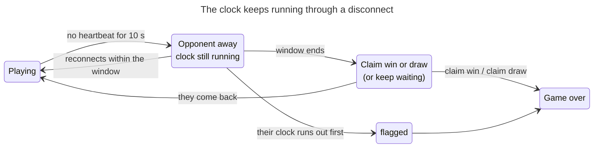
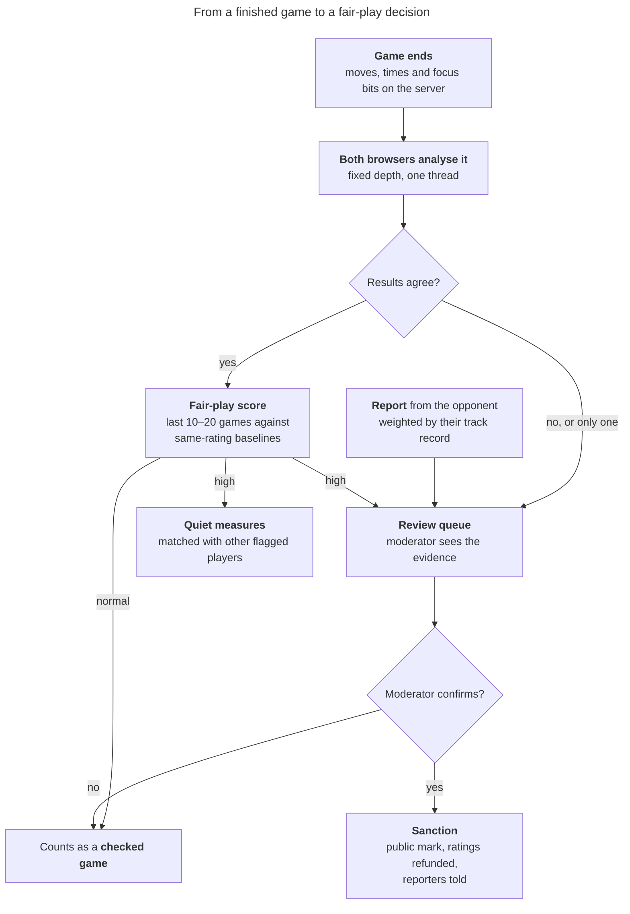
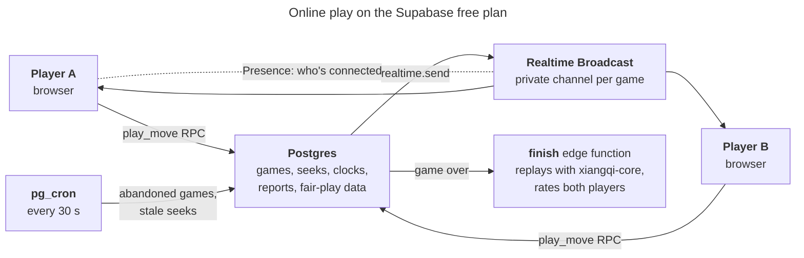

# Xiangqi School v0.3 — Online play design

> This file is the master copy of this design document. Update it here, in the same commit as the change it describes.

Oct 11, 2026 · Jet Zhu · **Draft for discussion**

v0.3 lets signed-in players play each other in real time. Three goals shape the design:

1. **Fair matches.** Opponents of about the same level, found quickly even when few people are online.
2. **Fair play.** Make cheating hard and unrewarding, catch it from the evidence, and never drive away an honest player who is falsely accused.
3. **Free to run.** It all fits Supabase's free plan and GitHub Pages, like the rest of the site.

It builds on the requirements study (R11 matchmaking, R24 anti-cheat, R41 fair timing, R45 game controls, R46 Xiangqi rulings, R63 safety) and on research done on 2026-10-11 into chess.com's help center, lichess's published rules and source code, Tiantian Xiangqi's fair-play notices, Ken Regan's statistical cheat-detection work, and Supabase's free-plan limits. Sources are at the end.

## Decisions to discuss

Each row is a proposal; the sections below explain them. Nothing is built yet.

| # | Question | Proposal |
| --- | --- | --- |
| D1 | Speeds | Three speeds, each with its own rating: **Lightning** (under 3 min), **Blitz** (3–10 min), **Rapid** (10 min and over), sorted by base + 40 × increment as chess.com and lichess do. No correspondence (daily) games in v0.3. |
| D2 | Matching | Quick-pair tiles that start at ±50 rating and widen every 5 s to ±200; players may widen to "anyone". Challenge a friend by link. Opponent filters: rating range, minimum games, account age, completion rate, and fair-play standing. |
| D3 | Reports on profiles | **Don't show raw report counts.** Show evidence instead: a completion rate (棋品, sportsmanship), "fair-play checked games", and confirmed violations only. Reports feed the review queue, weighted by the reporter's track record. |
| D4 | Detecting cheating | Record time per move, a focus bit per move, and server receipt times. After each game, analyse it with the engine in both players' browsers and compare. Score each player over their last 10–20 games against players of the same rating. Humans confirm before anything public happens. |
| D5 | Sanctions | Graduated, as Tiantian Xiangqi does: quiet separate matching for "likely" cases; on confirmation, a public mark, rated play suspended and ratings refunded to victims; a second confirmation closes the account. |
| D6 | Disconnects | The server keeps the clocks; they never stop. Reconnect window = estimated game length ÷ 10, from 30 s to 3 min; then the opponent may claim the win. |
| D7 | Chat | Preset phrases only (bilingual, like chess.com's Quickchat). No free text in v0.3. |
| D8 | Architecture | Moves go through a database function that keeps turn order and clocks; both browsers check legality and a server function replays the whole game at the end. Live updates use Supabase Realtime Broadcast. About 5,800 games a month fit the free plan. |

## Speeds and time controls

Xiangqi players know these as 闪电 / 超快棋 / 快棋. A game's speed is its estimated length, base + 40 × increment, the formula both chess.com and lichess use:

| Speed | Estimated length | Quick-pair tiles | First-move timer |
| --- | --- | --- | --- |
| Lightning 闪电 | under 3 min | 2+1 | 20 s |
| Blitz 超快棋 | 3 to under 10 min | 3+2, 5+3 | 30 s |
| Rapid 快棋 | 10 min and over | 10+0, 10+5, 15+10 | 45 s |

- Each speed has its own rating, because people play differently at each speed.
- A custom challenge allows any base from 1 to 60 min and any increment from 0 to 30 s; its speed follows from the formula.
- **Why only three speeds:** a small site has few players online at once, and every extra pool splits them further. Chess.com's ±200 window and lichess's waves assume thousands of players; here six tiles over three ratings is already plenty.
- **Lightning resists relaying.** Moving pieces between a phone running an engine and the board (the "RICE" pattern in the brief) costs several seconds a move, which Lightning doesn't leave. Fair-play checks still apply, with different expectations (see below).
- **Later:** per-move time (步时 / byo-yomi), correspondence games and tournaments. Correspondence is where outside help is easiest and slowest to detect, so it waits until the fair-play system has proved itself.

## Finding an opponent

### Quick pairing

The player picks a tile. The server pairs players of the same tile, nearest rating first, and among equal matches whoever waited longest.

- The rating window starts at **±50** and widens by 25 every 5 s up to **±200** (chess.com's cap for most players). A provisional player (rating uncertainty still high) starts at ±150.
- After 30 s the page offers to widen to **anyone**, to switch tile ("3 players are waiting in 5+3"), or to **play a bot while waiting**; the search keeps going and the bot game becomes casual if a match is found.
- Colours alternate: the player who had Red more often in recent games gets Black.
- The page shows how many players are seeking in each tile, so a quiet site doesn't feel broken.

### Challenge a friend

A link (and a short code to read out) that starts a game with chosen time, colour and rated or casual. It's the most reliable way to get a game on a small site, so it comes first in the milestones.

### Opponent filters

Set in Settings → Play, and applied both ways (you're only matched with someone whose filters also accept you), as on chess.com and lichess. Each filter shows how many players currently seeking would pass it, since narrow filters mean longer waits.

| Filter | Options | Default |
| --- | --- | --- |
| Rating range | −400 … +400 around your rating, or any | ±200 |
| Established players only | Hide provisional opponents (fewer than ~10 rated games at this speed) | Off |
| Account age | Any, 7 days, 30 days | Any |
| Completion rate (棋品) | Any, 90 %, 95 % | Any |
| Fair-play checked | Any, or at least 10 checked games with no finding | Any |
| Blocked players | Never matched, can't challenge you | — |

## Ratings

- Glicko, as the bot and puzzle ratings already use, one rating per speed.
- **Starting rating:** the player's bot rating if they have 10 or more rated bot games, otherwise the skill answer from sign-up (800 if skipped); high uncertainty, shown with a "?" until it settles (lichess clears it below an uncertainty of 110).
- Only rated games of at least 4 plies count, the same rule as bot games.
- A leaderboard per speed needs 30 rated games, a settled rating, play in the last 30 days, and at least 10 fair-play checked games.
- Rating floor: 100.

## The game

### Controls by moment

| Moment | Controls | Rule |
| --- | --- | --- |
| Before each side's first move | Abort | First-move timer per speed; if it runs out the game is aborted, unrated. |
| Playing | Resign (confirm), Offer draw, preset chat; Takeback request in casual games only | — |
| Draw offer | Accept / Decline next to the clock, no pop-up | Rated: from 20 moves each, as against bots. Moving declines it. The offerer waits 10 moves before offering again (lichess). |
| Takeback request | Accept / Decline | Casual only; each refusal lengthens the wait before the next request (10 s, 40 s, 90 s…). |
| Opponent disconnected | Countdown banner, then Claim win / Claim draw / Keep waiting | See Disconnects. |
| Game over | Result and reason in plain words, rating change, Rematch, New game, Game Review, Report | Analysis and Game Review unlock only now. |

- **Xiangqi rulings** come from `xiangqi-core`: checkmate, stalemate (a loss), perpetual check and chase, repetition and the natural move limit, stated in plain words ("Red loses: perpetual check").
- **No help during rated or casual human games:** no hints, eval bar, move feedback or threat arrows. While a game is in progress in this browser, the site's own analysis board shows "Analysis is off while you have a game in progress", and the game page notices if the site's engine starts in another tab.
- **Premoves** for Lightning and Blitz (one queued move); **confirm move** stays available for Rapid.

### Disconnects and reconnecting

- **The server keeps both clocks.** Each move is time-stamped by the database; a page that reloads, or a player who comes back on another device, reads the game and the clocks from the server and carries on. A disconnect never stops the clock, as the brief asks.
- **Reconnect window** = (base + 40 × increment) ÷ 10, at least 30 s and at most 3 min (chess.com's and lichess's formula). It's halved for a player down 4 or more points of material (lichess), and cut to 10 s if they closed the tab.
- When the window ends, the waiting player may **claim the win** (a draw if they don't have enough material to mate), **claim a draw**, or keep waiting. If **both** players are gone for more than the window, the game is a draw with no rating change.
- **Lag:** players are charged only for thinking time. The browser reports how long the player thought; the server credits the difference up to a small allowance per move with a bank that refills (chess.com: 200 / 300 / 500 ms per move by speed). A dishonest browser gains at most that allowance.
- A connection indicator next to each name shows the measured round trip; a clock that jumps after a lag correction shows a brief "adjusted for lag" note.

### Sportsmanship (棋品)

Bad behaviour hurts honest players almost as much as cheating, and unlike cheating it can be measured exactly. Each player's last 30 games are labelled:

| Behaviour | How it's recognised |
| --- | --- |
| Abandoning | Left and didn't return within the reconnect window. |
| Stalling | In a lost game, let the clock run down after idling longer than the reconnect window (lichess's "sitting"). |
| Frequent aborts | Aborted more than a few of the last 10 games after the opponent was seen. |
| Long first moves | Spent over half the base time on one of the first 10 moves (chess.com). |

- **Completion rate** = games finished normally (played to a result) ÷ games started, last 90 days. It's public, filterable, and only ever moves because of the player's own actions, so it can't be manipulated by opponents.
- **Penalties are private and gentle**, as on both big sites: a warning to acknowledge, then a pairing wait (10 min, multiplied for repeats within 3 days, at most a day), and matching with other players who do the same.

## Fair play

### The aim

Stop cheating paying off, without making honest players feel watched or accused. The research gives four principles that every big site follows:

1. **One game proves nothing.** Decisions come from several games compared with honest players of the same rating, never from a fixed percentage of "engine moves" (Regan: a fair 2100 player matches the engine's first choice about half the time).
2. **Reports start a review, they never decide it.** Chess.com dismisses all reports when no cheating is found, however many there are.
3. **Only confirmed findings are public.** No big site shows report counts or suspicion scores; they'd be a weapon for sore losers.
4. **A human confirms before anything public happens.**

### What's recorded

Recorded for every online game, cheaply, and said plainly in the fair-play policy:

| Data | Per | Why |
| --- | --- | --- |
| Server receipt time and reported think time | Move | Clocks, lag allowance, and the timing checks below |
| Focus bit: did the page lose focus between the opponent's move and this one? | Move | A player looking at another window every move (lichess's "blurs") |
| Engine analysis: loss against the best move, match with the engine's first choice, how many good moves there were (position difficulty) | Move, after the game | Accuracy against players of the same rating |
| Sportsmanship labels | Game | Completion rate and penalties |

Not recorded: mouse movement, clipboard, other programs, camera. They're intrusive and easily fooled.

### Who analyses the games, for free

There's no server that can run an engine for free, so the analysis runs where engines already run: in browsers.

- **Both players' browsers** analyse the finished game at a fixed depth with one thread, which gives the same numbers on every machine. Players get their Game Review from it anyway.
- **The two results are compared.** A cheater who fakes the analysis of their own game is contradicted by the opponent's browser. If only one browser sends results, the game waits for a second opinion from the moderator's review page (below).
- Games of **players rated 1800 and above, and anyone on a leaderboard, are always analysed**, as the brief asks. If neither player's browser did it, they go to the review queue.

### What counts as suspicious

Each signal compares a player with honest players of the same rating and speed; the site builds those baselines from its own games. The exact thresholds stay private, as on every big site.

| Signal | Honest players | Engine help |
| --- | --- | --- |
| Accuracy and first-choice match, middle-game moves only (about plies 16–120, skipping forced and book moves) | Spread around their rating's average | Far above it, game after game |
| Time against difficulty | Quick on obvious moves, long on hard ones | About the same time for every move; slow on obvious recaptures (the RICE signature) |
| Spread of move times | Varied | Unusually even (lichess flags a spread below 25 % of the average) |
| Fast moves | Some moves under half a second | Almost none |
| Focus lost | Now and then | On nearly every move |
| Results | Rating rises gradually | Sudden jump; wins against much stronger players |

- A game is scored from these together, and a player from their last 10–20 games: a "likely" verdict needs several games far out of line (Regan's threshold for statistics alone is about 5 standard deviations; lower values only add weight to other evidence).
- Games under 36 plies aren't scored, and a game the suspect lost counts for less (lichess).
- **Partial cheating** (a few engine moves in the critical moments) is the hardest case; scoring the middle game separately and weighting difficult positions helps.
- **Lightning** is scored with looser accuracy expectations and needs more games, because fast games are noisier.

### Reports

- **Who can report:** only a player of that game, within 7 days, once per game, at most 5 reports a day.
- **Reasons:** engine or outside help, stalling, abusive chat (presets can still be used to taunt), offensive username, other (with a short note).
- **Weight:** each reporter has a track record (reports confirmed ÷ reports made). Reports from accurate reporters move a case up the queue; reports from someone who reports every loss count for little; reporters with a confirmed violation of their own count for nothing. Persistent false reporting can lose the right to report.
- **A report starts work at once:** the suspect's recent unanalysed games go to the review queue.
- **The reporter sees:** "Thank you. Every report is reviewed; you'll be told if action is taken." If it is, they get a notice (no details) and any rating they lost to that player back.

### On the profile: what other players can see

The brief asks whether the number of times a player was reported should be on their profile so others can filter it out. The research argues against the raw count: one angry opponent, or a group of them, can make it climb without any cheating, and that drives away exactly the honest players we want to keep. Proposal: show evidence that **only the player's own actions** can change, and let filters use it.

| Shown on the profile | Can be filtered | Moved by |
| --- | --- | --- |
| **Completion rate 棋品** (e.g. 98 %) | Yes | The player's own aborts, abandonments and stalling |
| **Fair-play checked games** (e.g. "52 checked, none flagged") | Yes | Analysis of their games |
| **Fair-play violation**, with the date (only if confirmed by a moderator) | Yes ("hide") | A moderator's decision |
| Account age, rated games per speed, provisional "?" | Yes | Time and play |
| Raw report count, suspicion score | **No: never shown** | — |

The name is open (D3): "Fair-play record / 公平记录", "Sportsmanship / 棋品" and "Trust / 信誉" are candidates. If you still prefer a report figure, the safer form is **upheld reports** (reports a moderator confirmed), which honest players can't collect.

### Sanctions and appeals

| Level | When | What happens | Public? |
| --- | --- | --- | --- |
| Quiet | Score "likely", not yet reviewed | Matched only with other flagged players for rated games (lichess's separate pools); games queued for review | No |
| First confirmed violation | Moderator confirms | Rated online play suspended 30 days; ratings reset to provisional; **victims refunded** (rating lost to them in the last 3 months, up to 100 games, as chess.com); reporters told; public mark for 1 year | Yes |
| Second confirmed violation | Moderator confirms | Account closed for online play; mark stays | Yes |

- **Appeal** by email within 30 days, reviewed again with fresh eyes. Tiantian Xiangqi offers a supervised test match at the player's level; a version of that (a watched game against a trusted player) is an option for disputed cases.
- Every moderator action goes in an append-only log with the reason and the evidence.

### Moderation

At first the site owner is the only moderator. A **review page** (moderators only) shows, for each case: the games with the engine graph, time per move against difficulty, focus bits, the player's numbers against the same-rating baseline, and the reports with their reporters' track records. It runs the engine in the moderator's browser to fill gaps. A small player base means few cases; the queue is ordered so the strongest evidence and the highest-rated players come first.

## Safety

- **Guests** can't play online, as planned in v0.2.
- **Chat:** preset bilingual phrases only ("Good luck", "Good game", "Thanks", "Oops", "Well played"…), switchable off. No free-text chat in v0.3, so no profanity filter or chat moderation is needed yet.
- **Block** a player: no matching, no challenges.
- **Public profile** (new in v0.3): username, avatar, country flag, ratings per speed, completion rate, fair-play checked games and any confirmed violation. Players under 16 keep a minimal public profile (username and ratings only).
- A **fair-play policy** and a **sportsmanship policy** page, linked from the sign-up and Play pages, say what's forbidden, what's recorded and how decisions and appeals work.

## Architecture

The rest of the site doesn't change: a static site on GitHub Pages, Supabase for accounts and data.

- **Moves.** `play_move(game, ply, move, think_ms)` is a database function. It locks the game, checks that it's the caller's turn and the expected ply (so a repeated request does nothing), charges the clock from the database's own time stamps with the lag allowance, saves the move and broadcasts it. No edge function per move, so no added delay.
- **Legality** is checked by both browsers on every move (an illegal move from a tampered browser is reported at once by the opponent's) and by the `finish` function, which replays the whole game with `xiangqi-core` at the end, checks the claimed result and rates both players. An illegal move loses the game. Replaying a 150-ply game takes about 10 ms.
- **Time-outs** are claimed by the waiting player's browser and checked against the server's time stamps; a pg_cron job every 30 s ends games where both players have gone, aborts games whose first move never came, and clears old seeks.
- **Matchmaking** is a seeks table and a `find_match` function that pairs two seekers in one transaction (`FOR UPDATE SKIP LOCKED`), called every few seconds while searching so the window can widen.
- **Live updates** use one private Broadcast channel per game, readable only by its players. Presence on that channel drives the "opponent disconnected" banner; a heartbeat function every 20 s records when each player was last seen, which is what the server trusts.
- **New tables:** `games` (players, time control, moves as one ICCS string, clocks, times and focus bits per move, result), `seeks`, `online_ratings`, `game_analysis`, `reports`, `fairplay` (per-player scores and standing), `mod_log`, `blocks`. Written only by database and edge functions; row-level security as in v0.2.

### Free-plan budget

| Resource | Free plan | Use per game (100 plies) | Games it allows |
| --- | --- | --- | --- |
| Realtime messages | 2 million a month | about 340 | **about 5,800 a month (about 190 a day): the limit** |
| Realtime connections | 200 at once | 2 (open only on the play pages) | about 100 games at once |
| Edge function calls | 500,000 a month | 1–2 | far more |
| Database | 500 MB | about 2 KB plus analysis | over 100,000 games stored |
| Egress | 5 GB a month | about 150 KB | about 35,000 a month |

That's ample for a hobby site. To stay inside it: no spectating in v0.3 (each spectator costs a message per move), no global "who's online" Presence (the count comes from a database query), and a monthly check of the usage page. On the free plan going over doesn't cost money; Supabase warns, then restricts.

## Milestones

Numbering continues from v0.2. Each ends with tests, a commit and a deploy.

1. **M15 – Groundwork.** Online ratings, public profiles, block list, fair-play and sportsmanship policy pages, Settings → Play (filters, premoves, chat on/off).
2. **M16 – Play a friend.** Challenge link, server clocks, moves, resign, draw, abort, takeback (casual), reconnect, disconnect claims, the `finish` function, Game Review afterwards. End-to-end tests with two browsers.
3. **M17 – Quick pairing.** Tiles, seeks and widening windows, opponent filters, first-move timer, sportsmanship labels and pairing waits, "play a bot while waiting".
4. **M18 – Fair-play data.** Times and focus bits per move, two-browser analysis, same-rating baselines, game and player scores, checked-game counts on profiles.
5. **M19 – Reports and moderation.** Report flow, reporter track records, review page, mod log, sanctions, refunds, appeals, leaderboards.
6. **M20 – Launch v0.3.0.** A load test against the free-plan limits, then release.

## Open questions

- [ ] D1–D8 above.
- [ ] Names for the speeds in Chinese (闪电 / 超快棋 / 快棋) and for the profile record (D3): native-speaker check.
- [ ] Rated draw offers from 20 moves each (as against bots), or from the start as on chess.com? The minimum stops quick agreed draws used to swap rating points.
- [ ] Should online play need anything beyond a verified email (for example 3 completed bot games), to slow down throwaway accounts?
- [ ] Bot rating calibration before launch, since online starting ratings may come from bot ratings.
- [ ] Moderators besides the owner, later: who, and how they're trusted.

## Sources

Studied on 2026-10-11.

- **chess.com help center:** [different ratings by speed](https://support.chess.com/en/articles/8705367-why-are-there-different-ratings-in-live-chess), [matchmaking](https://support.chess.com/en/articles/8639319-how-does-matchmaking-work-in-live-chess), [live settings](https://support.chess.com/en/articles/8614003-how-do-i-manage-my-live-chess-settings), [abort](https://support.chess.com/en/articles/8609759-what-does-it-mean-to-abort-a-game-how-do-i-do-it), [abandonment](https://support.chess.com/article/338-how-does-game-abandonment-work), [lag forgiveness](https://support.chess.com/en/articles/8615369-what-is-lag-forgiveness-why-did-the-clocks-suddenly-change), [sportsmanship](https://support.chess.com/en/articles/8598007-what-is-chess-com-s-sportsmanship-policy), [premoves](https://support.chess.com/en/articles/8562432-what-are-pre-moves-and-how-do-they-work), [draws](https://support.chess.com/en/articles/8572743-how-do-draws-work), [report](https://support.chess.com/en/articles/8562517-how-do-i-report-someone), [what happens to cheaters](https://support.chess.com/en/articles/8588324-what-happens-when-someone-is-caught-cheating), [reported but didn't cheat](https://support.chess.com/en/articles/8598004-they-reported-me-for-cheating-but-i-didn-t-cheat-am-i-in-trouble), [fair play overview](https://www.chess.com/cheating), [2022 fair-play tools](https://www.chess.com/article/view/new-tools-for-fair-play-on-chess-com).
- **lichess:** [FAQ](https://lichess.org/faq) and its open-source server [lila](https://github.com/lichess-org/lila): pairing (`modules/pool`), playbans (`modules/playban`), report scoring (`modules/report`), player assessment (`modules/evaluation`), focus tracking (`ui/round/src/blur.ts`), lag compensation (scalachess `LagTracker`).
- **Statistics:** Ken Regan, [FIDE talk](https://cse.buffalo.edu/faculty/regan/Talks/FIDE84CongressTalkNoPauses.pdf), [2024 slides](https://cse.buffalo.edu/~regan/Talks/StLouisCCOct2024.pdf), [ECU arbiters' summary](https://arbiters.europechess.org/arbiters-corner-april-2025-prof-regans-statistical-system-explained/).
- **Xiangqi:** Tiantian Xiangqi (天天象棋) [2019 penalties](https://xiangqi.qq.com/webplat/info/news_version3/15003/24026/24036/24038/m15147/201904/801990.shtml) and [2018 notice](http://xiangqi.qq.com/webplat/info/news_version3/15003/24026/24036/24038/m15147/201712/675244.shtml).
- **Supabase:** [Realtime limits](https://supabase.com/docs/guides/realtime/limits), [message counting](https://supabase.com/docs/guides/platform/manage-your-usage/realtime-messages), [Broadcast](https://supabase.com/docs/guides/realtime/broadcast), [Presence](https://supabase.com/docs/guides/realtime/presence), [Edge Function limits](https://supabase.com/docs/guides/functions/limits), [pg_cron](https://supabase.com/docs/guides/cron), [pricing](https://supabase.com/pricing).
