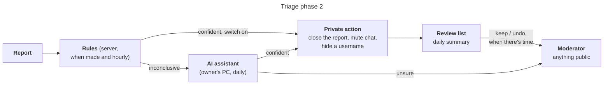
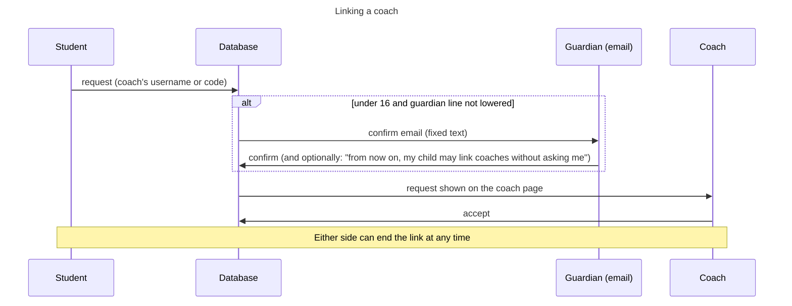

# Xiangqi School v0.4 — Community design

> This file is the master copy of this design document. Update it here, in the same commit as the change it describes.

Oct 21, 2026 · Jet Zhu · **Agreed plan, being built**

v0.4 adds four things around the game. All of them stay on the free plans:

1. **Feedback and support.** Anyone can tell us what to improve. Players who want to can help pay the running costs.
2. **Moderation that runs itself.** Triage takes its own private, reversible actions. A person reviews them later, when they have time.
3. **Coaching.** A player can link a coach, or a parent, who then sees their games.
4. **Child profiles.** A parent can create profiles for children under 13 under their own account, and coach them.

It builds on the research in [coaching-and-donations.md](coaching-and-donations.md): sections 1–2 cover coaching and donations, section 4 covers children and the legal memo. It also builds on report triage in [v0.3-online-design.md](v0.3-online-design.md#report-triage).

## Decisions (2026-10-21)

| # | Question | Decision |
| --- | --- | --- |
| E1 | Where donations are received | **The USA** (the owner is a US resident), for the worldwide site. The China-hosted site is on hold. |
| E2 | Donation buttons | **A Stripe Payment Link** and **GitHub Sponsors**. Stripe's link takes cards, Alipay and WeChat Pay, and shows ¥ or $ automatically. GitHub Sponsors charges no fee. The owner creates both accounts. The links are kept in site settings, where a moderator can change them without a release. Ko-fi is not used. |
| E3 | Triage phase 2 | **The assistant acts on its own** for private, reversible actions. Every automatic action goes on a review list with a summary. A moderator keeps it or undoes it whenever they have time. A category whose actions are undone too often switches itself off. |
| E4 | Where the AI adviser runs | **On the owner's PC**, on a daily timer, using Claude Code on the owner's subscription. It costs nothing extra, and case data never reaches public logs. The database rules act on the server around the clock. The AI catches up whenever the PC is on. |
| E5 | Feedback | **Everyone can send it**, guests included. There is no email field: a signed-in player can tick "you may reply to my account email", so we never collect a child's email. Sending is rate-limited. Moderators see feedback on the review page. The daily assistant groups it into themes. |
| E6 | Coaching | The plan in coaching-and-donations.md section 1, as decided on 2026-10-20: the player starts the link, and a guardian confirms for under-16s (a parent may lower that line to 13). A coach can have up to 15 students under 16, and a parent up to 3 of their own children. A coach sees an opponent under 16 only as "an opponent under 16". There is no messaging. |
| E7 | Child profiles | **Built from the legal research memo** (section 4) with all 13 changes it lists, without waiting for a lawyer. **Not offered to families in mainland China** until a Chinese lawyer has advised. The parent is the only coach. A child profile has no online play, no public profile and no chat. |

## Feedback and support (M21)

- **Feedback page** (`/feedback`, linked from the footer and Help). It has a kind (a problem, an idea, lessons or puzzles, translation, something else) and a message of up to 2,000 characters. The page address and the site version are attached automatically. A signed-in player can tick "you may reply to my account email". Guests can send too. Rules: 5 a day per account, and for guests 5 a day per network. The network is kept only as a salted hash that changes daily, never as an address. The page asks people not to include personal details.
- **On the review page**, a Feedback tab lists items by status: new, noted, planned, done, or won't do. Each has a private note. A reply is sent by hand from the moderators' email, and only when the player allowed it.
- **Support page** (`/support`, 支持我们). It says the site is free with no ads, forever, and is run by one volunteer. Gifts are personal and not tax-deductible. It shows what the site costs today ($0 a month) and what money would pay for. Donations never unlock anything in play. "Under 18? Please ask a parent first." Refunds are given on request within 30 days. The page links to the spending report.
  - The buttons come from site settings and are hidden until a link is set.
  - Children's accounts never see the Support page links.
- **Spending report** (`docs/costs.md`), updated each quarter.

## Moderation that runs itself (M22)

- **The actions.** Each one is private and reversible:
  - Close a likely-invalid report. It doesn't count against the reporter until a person keeps the action.
  - Mute a player's chat for 7 days. Their phrases aren't shown to opponents, and they see "Chat is paused until …".
  - Hide an offensive username. The player is shown as "Player 1234" until they choose a new name; the old one is kept for an undo.
  - Engine help needs no new action: "likely" players already get quiet matching.

  Anything public (a mark, a suspension, refunds), second offences and appeals stay with a person.
- **Who may act.** The rules act when a verdict is confident (0.8 or more) and that category's switch is on. The AI assistant acts when it is confident and the rules don't disagree. Its answers keep the same shape: a verdict, a confidence, a reason, and now a suggested action.
- **The review list** sits at the top of the review page. It shows each automatic action, who took it (`rules` or `ai:<adviser>`), the reason, and Keep / Undo buttons. Undo reverses the action and reopens the report. Both choices are logged.
- **Switching itself off.** If more than 1 in 10 of a category's last 20 reviewed actions were undone, its switch turns off. The moderators see a notice. A moderator can turn it back on.
- **The daily summary** is written by the assistant run and kept in the database. It covers actions taken since the last summary, cases that need a person, feedback themes, and anything odd (a burst of reports, a category switched off). The review page shows the newest summary.
- **The daily run** is one portable Node script, `packages/triage/scripts/daily.mjs`. It advises, acts and writes the summary, and keeps a local log.
  - `schedule.mjs install` sets it up with the system's own scheduler: a systemd user timer (or a crontab line) on Linux, a launchd agent on macOS, a Task Scheduler task on Windows.
  - So any one computer with Node, the repository, a signed-in Claude Code and the Supabase token can run it, and it can move between machines (moderator runbook, "Setting up the daily run").
- **Switches on.** `auto_stalling`, `auto_chat`, `auto_username`, `auto_engine` and `auto_other` are turned on with this milestone; for engine and "other" the only step is closing an unfounded report, at the owner's request (2026-10-21). They had not yet earned the 95% agreement the phase 1 plan asked for, so the review list and the self-switch-off take its place.

## Coaching (M23)

### Email from the site

Guardian confirmations, the notice to parents and digests need email beyond sign-in. A **mail outbox** handles them:

- Rows go into a `mail_outbox` table.
- A small `mailer` function sends them every minute over the same Gmail SMTP that sign-in uses. The app password is a function secret.
- Each message uses a fixed bilingual template. Users never write the text.
- Limits: 3 guardian emails a day per player, 100 emails an hour in all.

### Linking

- **Who may coach.** An adult (18 or over by birth month) with a confirmed email, an account at least 7 days old, and no bar from coaching.
- **Linking.** The student asks by the coach's username, or enters a one-time code from the coach (valid 24 hours). An adult never reaches a child first.
  - A student marks the request "this is my parent or guardian" for a family link. It counts toward the parent's 3 and not toward the coach's 15.
- **Guardian confirmation.** It applies to players under 16 unless the line is lowered:
  - The student gives a guardian's email. The guardian gets a fixed email and confirms on a page, where they may also lower the line to 13 for this child. That choice is logged and can be changed back from the same page by email.
  - A guardian email is kept only until the link is confirmed or ended, then cleared. Its hash is kept, to recognise the same guardian next time.
- **Caps.** A coach can have 15 linked students under 16; the 16th request waits for a moderator. A parent can have 3 family links.
- **What a coach sees.**
  - Their students' finished online games, replays and Game Reviews, and their ratings.
  - Not chat, games in progress, lessons or puzzles.
  - A game's opponent under 16 who isn't also the coach's student shows as "an opponent under 16".
  - `game_info` gains the coach rule. Every game a coach opens is logged.
- **The student's side.** Settings → Coaches lists links, requests and the visit log (what each coach opened, when), with End link.
- **The coach page** (`/coach`). It lists requests to accept, then students with their ratings, recent games and links to the reviews. The coach can end a link and create a code.
- **Moderation.**
  - "Report this coach" is on the student's Coaches list.
  - Coach reports join the review queue as their own kind.
  - A moderator can end a link, bar or unbar an account from coaching, and approve a coach over the cap.

## Child profiles (M24)

The plan agreed on 2026-10-20 (coaching-and-donations.md, "Plan for children under 13"), with the legal memo's changes.

- **What a profile is.** A child profile is its own sign-in identity: a user account with no email or password of its own, managed by the parent's account. Every existing table and page then works for the child unchanged: lessons, puzzles, bots, ratings and analysis. Only a parent can open it.
  - "Switch to [name]" signs the parent out on that device and signs the child in, through a server function that checks the parent owns the profile.
  - Getting back to the parent's account means signing in again, so a child can't reach the parent's account and play strangers.
- **Creating one.** It is created in Settings → Children, after the parent confirms it's them: a password, or a fresh sign-in for Google, GitHub or Microsoft accounts, within the last 10 minutes.
  - The parent gives a nickname (not shown anywhere public), a birth year, and a country.
  - Mainland China is refused with an explanation (E7).
  - The parent can have up to 3 child profiles, the same number as family links.
- **Consent ("email plus").**
  - Before anything is kept, the parent reads the notice. It covers: what is kept, why, how long, where (US servers), who sees it (only the parent), the services that process it, the parent's rights, how to revoke consent, and the operator's contact.
  - The profile stays unconfirmed until the parent clicks the confirmation email. A second email follows 24 hours later, repeating the notice and how to revoke.
  - Korean families type 동의 (or an explicit statement) on the confirmation page. The text is recorded.
  - Unconfirmed profiles are deleted after 14 days.
- **What the child can do.** Lessons, puzzles, bots and analysis, with progress saved. No online play, no public profile, no leaderboard, no chat, no feedback email, no Support links.
  - In Vietnam, a child aged 7 or over sees a short "Your parent can see your progress. Is that OK?" screen the first time.
  - Every child sees a child-friendly line saying their parent can see their progress.
- **The parent as coach.** Every confirmed profile is automatically linked to its parent as a family link. The parent sees the child's games and progress. No other coach, and no online play, is possible without a stronger consent method, which is not built.
- **The parent's controls.**
  - See everything and export it.
  - Delete the profile at once: its data goes, and the consent record stays as proof.
  - Withdraw consent, which deletes the profile.
- **At 13**, the parent can turn the profile into the child's own account by giving the child's email. The child sets a password from the emailed link, and the history is kept.
- **Retention.** Profiles unused for 24 months are deleted after an email warning. Consent records are kept 3 years after the profile ends.
- **Paperwork** (in `docs/`):
  - a written security programme (`security-programme.md`: the coordinator, a yearly review, safeguards, a yearly test)
  - a children's data impact assessment covering the UK, the EU and China (`children-impact-assessment.md`)
  - the processors' terms on file (Supabase, Google)
  - a children's section in the privacy policy with the operator contact block, and the retention policy

## Milestones

Numbering continues from v0.3. Each milestone ends with tests, a commit and a deploy.

1. **M21 – Feedback and Support.** The Feedback page and its review tab, the Support page with donation links from site settings, and the spending report. Built 2026-10-21 (migration `20261024000000_feedback_support.sql`): also a footer on every page (Feedback, Support us, Privacy, Terms), a Feedback section in Help, the review page split into Queue, Feedback and Site settings tabs, and a feedback and donations section in the privacy policy. To go live: the owner creates the Stripe Payment Link (cards, Alipay, WeChat Pay; pay what you want) and the GitHub Sponsors profile, then pastes both links into Site settings.
2. **M22 – Triage phase 2.** Automatic actions (closing reports, chat mutes, hidden usernames), the review list with Keep / Undo, self switch-off, the AI assistant acting, the daily summary, and the PC timer. Built 2026-10-21 (migration `20261025000000_triage_phase2.sql`, `packages/triage` digest, `daily.mjs` and `schedule.mjs`):
   - A report closed automatically has status `auto-closed`. It leaves the queue but counts for or against the reporter only once the step is kept.
   - All five categories are switched on. Engine and "other" reports are only ever closed when unfounded: a confident "likely invalid" verdict closes them.
   - Self switch-off: more than 1 in 10 of a category's last 20 reviewed steps undone, and at least 2.
   - A summary more than two days old shows a warning on the review page, so a stopped PC timer is noticed.
3. **M23 – Coaching v1.** The mail outbox, coach links and codes, guardian confirmation, caps, the coach page, the coach rule in `game_info`, the visit log, and coach reports and bars.
4. **M24 – Child profiles.** Managed profiles, the consent flow and notice, the switch, the parent's controls, retention jobs, the policy pages and paperwork.
5. **M25 – Release v0.4.0.**
